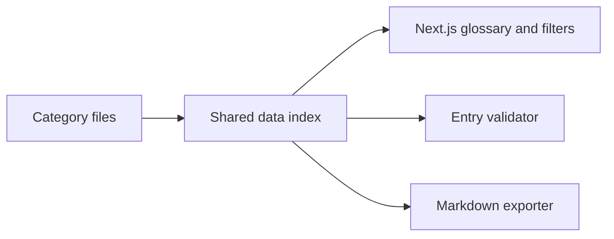

# The Engineer's Field Manual

A searchable glossary of 289 engineering terms — backend, data, infrastructure,
security, and AI — written for people entering engineering and for people who
have been shipping for years but never had the words handed to them.

Every entry has three parts: what the term means, the specific way it goes
wrong in production, and — behind an **In depth** toggle — the mechanism
underneath, with the numbers, flags and failure modes attached. The second and
third parts are the ones that are usually missing.

[Get started](#run-it) · [Architecture](#architecture) · [Contribute](#adding-a-term)

## Why this exists

Engineering vocabulary is easier to remember when it is connected to a failure you can recognize. This manual pairs definitions with operational consequences and deeper explanations, giving learners and working engineers a reference they can search while reading code or debugging systems.

## Architecture



The site, validator, and exporter share one data index, so term slugs, categories, and related links have a common source of truth.

## Run it

```bash
npm install
npm run dev      # http://localhost:3000
npm run build && npm start   # production
npm run export:md            # regenerate docs/field-manual.md
```

Node 18.17+ required. No database, no environment variables, no API keys.

## Structure

```
app/
├── layout.js       fonts + metadata
├── page.js         assembles sections, owns the layer-filter state
└── globals.css     the whole design system (cyanotype blueprint)
components/
├── Hero.js         request-path selector; picking a stage filters the glossary
├── Glossary.js     search + category/layer filtering + highlighting
└── Sections.js     learning path, toolkit, footer
data/
├── taxonomy.js     16 categories, 8 layers
├── terms/          one file per category, each exporting TERMS
├── route.js        the learning path, with term slugs
├── slug.js         the one slug function shared by site, validator, exporter
├── toolkit.js      what library for what, with the reason attached
└── index.js        merges, slugs, search fields and related-term links
lib/
└── search.js       ranked search (name > alias > definition > body)
scripts/
├── validate.mjs    checks every entry against docs/style-guide.md (`npm test`)
├── planned-terms.json   terms scheduled for v2, by category
├── slugs-v2.txt    every slug a `see` link may point at
└── export-markdown.mjs  renders the manual to markdown
docs/
├── style-guide.md  the entry standard: seven fields, rules, levels, idioms
└── field-manual.md generated — the whole manual as one readable file
```

## v2 status (in progress)

Version 2 upgrades every entry from three fields to seven: definition,
**plain words**, **example**, where it goes wrong, in depth, **related
terms** and a **level** (Foundation / Working / Advanced). The standard is
written in the [entry style guide](docs/style-guide.md).

Done so far:

- Data split into one file per category (lossless; 289 terms unchanged).
- Validator (`npm test`) with a per-file mode: `node scripts/validate.mjs --only ai`.
- Ranked search helper, shared slug function, learning-path slugs.
- Three exemplar entries in the v2 shape: Idempotency, N+1 query, Hallucination.
- 108 missing terms identified by scanning definitions for undefined words
  (client/server, latency, pod, kernel, tenant, WAL, join, middleware …);
  listed in `scripts/planned-terms.json`.

Not done yet: the other 286 entries still lack `plain`, `example`, `see`
and `level`, so `npm test` currently reports those as errors by design. The
site builds and runs unchanged. The UI for the new fields is not built yet.

## Adding a term

Add an entry to the appropriate file in `data/terms/`. The example below shows the original entry shape; new entries should also follow the v2 fields in the [style guide](docs/style-guide.md):

```js
{
  t: "Term name",
  aka: "optional alias",
  c: "async",        // category id from taxonomy.js
  l: "app",          // layer id from taxonomy.js
  def: "What it is, in one sentence.",
  note: "The way it bites you in production.",
  depth: "Two to four sentences on the mechanism underneath — the flag, the " +
    "number, the specific failure. Never a restatement of def or note.",
}
```

Counts, search index, filters and the category chips all update automatically.
`npm run export:md` fails loudly if any entry is missing a field or points at a
category or layer that does not exist, so it doubles as the data test.

## Design notes

Cyanotype blueprint: Prussian ground with a drafting grid, chalk line work,
signal amber reserved for anything carrying a warning. Space Grotesk for
display, IBM Plex Sans for body, IBM Plex Mono for the terms themselves —
because a term is a thing you type. Amber marks warnings; the cyan rule marks
the **In depth** passage, which is reference, not alarm.

Press `/` anywhere to focus search, `Esc` to clear. Search covers the depth
passages too, so a match may be waiting inside a collapsed panel.
