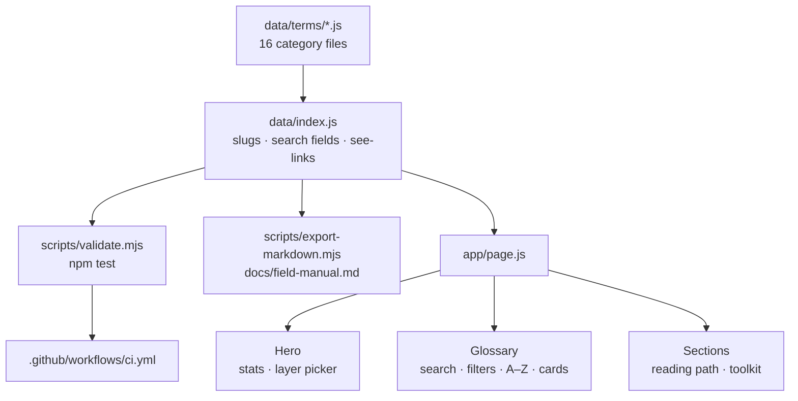

# Blueprint — Field Manual v2 (glossary enhancement)

**Type:** MODIFY · **Date:** 2026-09-09 · **Status:** Executed autonomously — assumptions stated in §0

| | |
|---|---|
| **What** | Turn a 289-term glossary written for experienced engineers into one a beginner can learn from, without losing the depth. |
| **Effort** | L (one working day with parallel writers) |
| **Done when** | `npm test && npm run build` pass, every term has all seven fields, no entry uses a term the glossary does not define, and the site shows plain words + example + related links per term. |

## 0. Assumptions (no reviewer available)

- "grocery" in the request means **glossary** (the repository name).
- The reader is a beginner-to-intermediate engineer reading English as a second language. Every change is judged against that reader.
- Keep the existing voice in the "Where it goes wrong" and "In depth" layers; add clarity **around** them rather than rewriting them.
- Do not commit or push. The user asked to clone and enhance; committing is their call. Rollback point: commit `8b94964`.
- Keep Next.js at 14.2.5. A major upgrade is unrelated risk.

## 1. Needs & Goals

**For whom:** an engineer entering backend / data / AI work who meets these words in code review and cannot look them up fast enough.

| | |
|---|---|
| **Now** | One page, 289 terms, each with a one-line definition, an amber "how it bites" line, and a collapsible "In depth" passage. Search, category and layer filters. |
| **Problem** | Dense idiomatic prose; no examples; no cross-links; ~50 terms are used inside entries but never defined; no deep links; no reading order; hero shows wrong layer count. |
| **Adding** | An entry standard (style guide), plain-words + example + related + level on every term, ~100 missing terms, deep links, A–Z view, ranked search, level filter, a validator wired to `npm test`, CI, README. |
| **After** | A beginner opens any term and gets: definition → plain words → concrete example → where it goes wrong → in depth → related terms, and can share a link to it. |

| Goal | How we know it's met |
|---|---|
| G-1 Every term readable by a beginner | 100% of terms have `plain` (≤ 30 words) and `example` with a concrete detail; validator enforces it |
| G-2 No undefined jargon | Every term named in the gap scan (`docs/style-guide.md` §7) has an entry |
| G-3 Navigable as a reference | Each term has a URL (`/#slug`), 2–4 related links, and an A–Z view |
| G-4 Nothing regresses | `npm test`, `npm run build`, `npm run lint` all pass; export diff shows only intended changes |

## 2. Scope

| In | Out (for now) |
|---|---|
| Data schema v2 (`plain`, `example`, `see`, `level`) on all terms | Multi-page routing (one term per URL) — anchors are enough |
| ~100 new terms from the gap scan | Translations / i18n |
| One data file per category | Upgrading Next.js major |
| Validator (`npm test`), CI workflow, README, style guide | Analytics, comments, accounts |
| UI: legend, labels, level badges, related chips, anchors, copy link, ranked search, result count, level filter, A–Z, URL state, density toggle, print CSS | Light theme (cyanotype is single-look by design) |
| Hero fixes (layer count, path selector), reading-path links, two toolkit groups | Rewriting existing `note`/`depth` prose beyond banned idioms |

## 3. Entry Criteria

- [x] Repo cloned to `~/Documents/glossary` (check: `git -C ~/Documents/glossary log --oneline | head -1` → `8b94964`)
- [x] Node ≥ 18.17 (check: `node --version` → v26.7.0)
- [x] Baseline green (check: `npm run export:md && npm run build`)
- [x] Gap scan run (evidence in style guide §7)

## 4. Requirements

- R-1 Every entry must follow one written standard that a contributor can apply without asking.
- R-2 A beginner must be able to understand any entry from the first three fields alone.
- R-3 The glossary must not use a term it does not define.
- R-4 Every term must be linkable and must link to its neighbours.
- R-5 The data must be validated by a command, and CI must run it.
- R-6 The site must state true numbers about itself (term count, layer count).

## 5. Functional / Non-functional

> **Functional = WHAT it does.** A feature. "User can log in."
> **Non-functional = HOW WELL it does it.** A measurable quality. "Login answers in under 2 seconds."
> **Quick test:** can you demo it? → Functional. Does it need a number? → Non-functional.

**Functional — what it does**
- FR-1 A reader can open `/#idempotency` and land on that term with its depth panel open.
- FR-2 A reader can filter to Foundation terms only ("Start here").
- FR-3 A reader can switch between "by area" and "A–Z" views.
- FR-4 A reader can search and see results ranked name → alias → definition → body, with a result count.
- FR-5 A reader can click a related term and jump to it.
- FR-6 A reader can copy a term's link from its card.
- FR-7 A contributor can run `npm test` and get a list of every rule an entry breaks.

**Non-functional — how well** (each ends with a number)
- NFR-1 Speed: search re-renders under 50 ms for 400 terms (pure in-memory filter; no network).
- NFR-2 Security: 0 external scripts; fonts only from Google Fonts; no user input persisted beyond `localStorage` density toggle.
- NFR-3 Reliability: validator rejects any entry missing 1 of 7 required fields or referencing 1 unknown slug.
- NFR-4 Observability: validator prints file, term, and rule for every failure; export prints term and word counts.
- NFR-5 Accessibility: every interactive control is a `<button>` or `<a>` with a visible focus ring; contrast ≥ 4.5:1 for body text.

## 6. Architecture

| Layer | Choice | Why | Instead of |
|---|---|---|---|
| Framework | Next.js 14 (existing) | Already there; static export of one page | Astro / plain HTML (rewrite for no gain) |
| Data | Plain JS modules, one per category | Diffable, no build step, agents can edit in parallel | JSON / YAML (loses comments and multi-line strings) |
| Validation | Node script, `npm test` | Zero dependencies; runs in CI in < 1 s | Zod / JSON schema (new dependency for 12 rules) |
| Search | In-memory scoring in the client | 400 terms; no index needed | Fuse.js / Algolia (dependency, no measurable gain) |
| URL state | `useSearchParams` + `router.replace` | Shareable filters, no reload | Local state only (not shareable) |
| CI | GitHub Actions: `npm ci && npm test && npm run build` | Repo is on GitHub | None (validator never runs) |



**Flow:** 1. Category files export arrays. 2. `index.js` merges them, derives slugs, search fields and resolved related links. 3. Validator and exporter import the same index. 4. Page renders; Glossary reads URL params and hash for state.

## 7. Folder Structure

```
glossary/
├── app/
│   ├── layout.js            # fonts + metadata (edit: description, openGraph)
│   ├── page.js              # assembles sections (edit: Suspense, nav links)
│   └── globals.css          # design system (edit: new card sections, badges, A–Z, print)
├── components/
│   ├── Hero.js              # stats + layer picker (edit: 8 layers, fixed path)
│   ├── Glossary.js          # search/filter/cards (rewrite: ranked search, A–Z, URL state, anchors)
│   ├── TermCard.js          # one term (add: extracted from Glossary)
│   └── Sections.js          # reading path, toolkit, footer (edit: linked terms)
├── data/
│   ├── taxonomy.js          # categories + layers (edit: remove alias hack)
│   ├── terms/               # add: one file per category, exports TERMS
│   │   ├── structure.js … career.js
│   ├── route.js             # add: reading path steps with term slugs (validated)
│   ├── toolkit.js           # edit: + Build agents, Serve models
│   └── index.js             # edit: merge, slugs, search fields, BY_SLUG, related resolution
├── scripts/
│   ├── validate.mjs         # add: all rules, --only <category>
│   └── export-markdown.mjs  # edit: render new fields, reuse validator
├── docs/
│   ├── style-guide.md       # add: the entry standard
│   ├── PLAN-modify-glossary-v2.md  # this file
│   └── field-manual.md      # generated
├── .github/workflows/ci.yml # add
├── .eslintrc.json           # add
├── .nvmrc                   # add
└── README.md                # rewrite
```

| File | Action | Change |
|---|---|---|
| `data/terms-a.js`, `terms-b.js`, `terms-c.js` | remove | Replaced by `data/terms/<category>.js` (lossless, verified by export diff) |
| `data/taxonomy.js` | edit | Delete `LAYER_ALIASES`; `resolveLayer` stays as a safe lookup |
| `scripts/export-markdown.mjs` | edit | Import validator; render plain/example/level/see |
| `package.json` | edit | `test` script, `engines`, version 2.0.0 |

## 8. Change Impact

| Depends on it | Could break | Test to run |
|---|---|---|
| `data/index.js` consumers (page, Hero, Glossary, Sections, export) | Import paths after file split | `npm run build` |
| `resolveLayer` callers | Removing alias if any term still uses `l: "api"` | `npm test` (unknown layer rule) |
| Markdown export | New fields missing on old entries | `npm run export:md` |
| Search UX | Ranking regressions | Manual: search "lock", expect "Lock / mutex" first |

## 9. Phases

| # | Goal | Tasks | Files | Effort | You'll see |
|---|---|---|---|---|---|
| 1 | Standard + evidence | Write style guide; run gap scan; fix 3 exemplar entries by hand | `docs/style-guide.md` | S | A written rulebook with a worked example |
| 2 | Lossless restructure | Split into per-category files; fix `l:"api"`; extend validator; `npm test` | `data/terms/*`, `scripts/validate.mjs` | S | `npm test` passes; export diff = 1 intended line |
| 3 | Content | 16 parallel writers add plain/example/see/level to all terms and write the gap-scan terms; each passes `--only` validation | `data/terms/*` | L | ~390 terms, every rule green |
| 4 | UI | Legend, labelled sections, level badges, related chips, anchors + copy link, ranked search + count, level filter, A–Z, URL state, density, hero fixes, linked reading path, print CSS | `components/*`, `app/*` | M | The new card layout in the browser |
| 5 | Ship-ready | README, CI, eslint, nvmrc, export regenerated, build, lint, Chrome screenshot, spot-check 3 entries per file | root, `docs/` | S | Green build, screenshot, final report |

## 10. Risks & Rollback

| Risk | Mitigation |
|---|---|
| Parallel writers produce inconsistent voice | One style guide with a worked example; three exemplars I wrote; `--only` validator; spot-check 3 entries per file and cut weak ones |
| Invented numbers or flags in new entries | Numbers policy in style guide: only well-documented defaults, else omit; spot-check targets numbers first |
| Restructure loses or reorders content | Export before/after and `diff`; only the api→edge tag may differ |
| `useSearchParams` breaks static build | Wrap Glossary in `<Suspense>` |
| Cards become too tall for scanning | Density toggle (Compact / Full), persisted in `localStorage` |
| Validator too strict for future contributors | Errors for structure, warnings for style (word counts, reciprocity) |

**Rollback:** `git -C ~/Documents/glossary checkout -- . && git clean -fd` (uncommitted) · after commit: `git revert <sha>`
